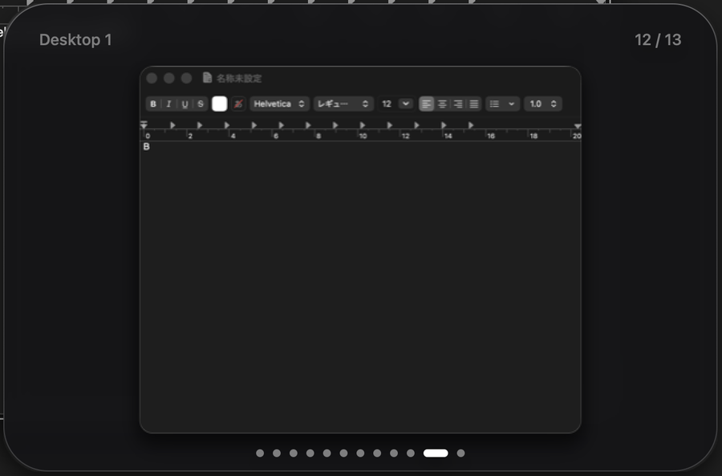

<h1>
  <picture>
    <source media="(prefers-color-scheme: dark)" srcset="assets/wordmark-dark.svg">
    
  </picture>
</h1>

A tiny macOS daemon for workspaces, a window switcher and a focus border.

- Switch between up to 10 desktops with one key. macOS Spaces and SIP stay untouched.
- Move a window to another desktop with Shift.
- Switch windows with a Tab switcher: a list, a big square preview, or instant.
- Draw a thin ring around the focused window.
- Optionally show the windows on this desktop in the menu bar.

<p align="center">
  <br>
  
</p>

## Install

### App

Download `just-desktops-<version>.app.zip` from [Releases](https://github.com/n-seiji/just-desktops/releases), unzip it and move `just-desktops.app` to `/Applications`.

Homebrew (`brew install --cask n-seiji/tap/just-desktops`) is coming soon, once the tap exists.

1. Open the app. It has no Dock icon. Its item is always in the menu bar.
2. The build is ad-hoc signed and not notarized. Right-click the app and choose Open. On macOS 15 and later, use System Settings > Privacy & Security > Open Anyway.
3. The first run explains the Accessibility permission. Click Open System Settings and turn it on. The app starts as soon as you do.
4. Screen Recording is asked for only when the switcher is `square`.

Click the menu bar item (right-click on the windows strip) for the menu: switcher style, focus border, menu bar style, Launch at Login, Open Config File and Quit. Choosing a setting writes that one line of the config and restarts the app. Windows parked on other desktops come back to the screen, as after any launch. Keys, modifier, pins and `no_preview` are edited in the config file.

Ad-hoc signed apps are identified by their code hash, so macOS asks for these permissions again after every update.

The app and the launchd service below must not run together. The second instance exits at once.

### CLI

```sh
mise use -g github:n-seiji/just-desktops
just-desktops
```

macOS asks for Accessibility. Allow `just-desktops` (or your terminal, if you started it there). On exit, every parked window is moved back.

To start at login, run this inside the repository:

```sh
mise run service     # register and start a LaunchAgent
mise run unservice   # stop and unregister it
```

Upgrading through mise changes the binary path. Run `mise run service` again and re-grant Accessibility.

## Quick start

- Hold the modifier (Option) and press `1`, `2`, `3`, `Q`, `W` or `E` to go to Desktop 1 to 6.
- Add Shift to move the focused window to that desktop.
- Hold Option and press Tab to pick a window on this desktop. Release Option to go there.
- The config is `~/.config/just-desktops/config`. All options are optional. Restart to apply changes.

## Keys

`⌥` is the base modifier. It is Option unless you set `modifier`.

| Key | What it does |
|---|---|
| `⌥1` `⌥2` `⌥3` `⌥Q` `⌥W` `⌥E` | Switch to Desktop 1 to 6 |
| `⌥⇧` + the same key | Move the focused window to that desktop |
| `⌥Tab` / `⌥⇧Tab` | Select the next / previous window. Wraps around |
| Release `⌥` | Switch to the selected window |
| `Esc` | Cancel the switcher |

## Configuration

File: `~/.config/just-desktops/config`. See [config.example](config.example).

| Option | Values | Default | What it does |
|---|---|---|---|
| `border` | `on`, `off` | `on` | Ring around the focused window. `off` creates no border window |
| `switcher` | `list`, `square`, `off` | `list` | Tab switcher style. `on` means `list`, unknown values too |
| `menubar` | `on` (or `strip`), `icon`, `off` | `off` (app: `on`) | Menu bar item: one glyph per window, or only a small app icon. The app always has an item, so `off` means `icon` there |
| `keys` | up to 10 digits or letters | `1 2 3 q w e` | The n-th key is Desktop n |
| `modifier` | `opt`, `cmd`, `ctrl` | `opt` | Base modifier of every hotkey. See [modifier](docs/workspaces.md#modifier) |
| `no_preview` | bundle ids | none | Apps the square switcher never screenshots. Repeatable |
| `<bundle id>` | `<n>` | none | Pin an app to Desktop n |

```
switcher = square
menubar = on
com.apple.Safari = 1
```

## Details

- [Switcher](docs/switcher.md): the three styles, the delay, Screen Recording, password managers.
- [Menu bar](docs/menubar.md): glyphs, the `+k` panel, clicking.
- [Workspaces](docs/workspaces.md): pins, pulling windows, the border, modifier conflicts.

## Design

- **One process.** Workspaces, the switcher and the border live in one daemon.
- **Mostly C.** The Objective-C is `src/apps.m` (app launch, quit and activation events) and `src/menubar*.m` (the status item and its panel and menu, created only when `menubar` is not `off`; `src/app.m` is the app's first-run panel, login item and config helpers).
- **Border through SkyLight**, like JankyBorders, so no NSWindow is created.
- **Hotkeys through a CGEventTap** on the main run loop. No extra threads.

It mixes two tools: [AeroSpace](https://github.com/nikitabobko/AeroSpace) (windows on inactive workspaces are parked in a corner) and [JankyBorders](https://github.com/FelixKratz/JankyBorders) (the border). For tiling, layouts or colors, use those.

## Memory

Measured with `footprint`.

| State | Memory |
|---|---|
| Idle, `menubar = off` | about 8MB |
| Idle, `menubar = on` | about 13.6MB |
| `list` open | peak about 16MB |
| `square` open | peak about 25MB |

The switcher memory is released when you let go of `⌥`. More in [switcher](docs/switcher.md#memory) and [menu bar](docs/menubar.md#memory).

## Development

Needs the Xcode Command Line Tools and [mise](https://mise.jdx.dev). Use `mise run build`, `mise run run` (build and run in the foreground), `mise run test` and `mise run test-san` (the same tests under the address and undefined behaviour sanitizers). `scripts/footprint.sh [config-file] [seconds]` prints the idle footprint in bytes; stop any running instance first. Pushing a `v*` tag publishes arm64 and x86_64 binaries to Releases. [docs/architecture.md](docs/architecture.md) maps the code: modules, data flow, threading and the memory rules.

## Limitations

- Windows are parked on the main display only. Multiple displays are not supported yet.
- SkyLight is a private Apple API, so a macOS update can break the border.
- After a crash, parked windows stay in the bottom-right corner until the next launch moves them back.
- Only the desktop keys and the base modifier are configurable.

## License

[GPL-3.0](LICENSE).

## Support

If just-desktops saves you a few keystrokes a day, you can [buy me a coffee](https://buymeacoffee.com/sijis).
